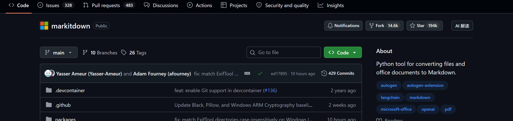
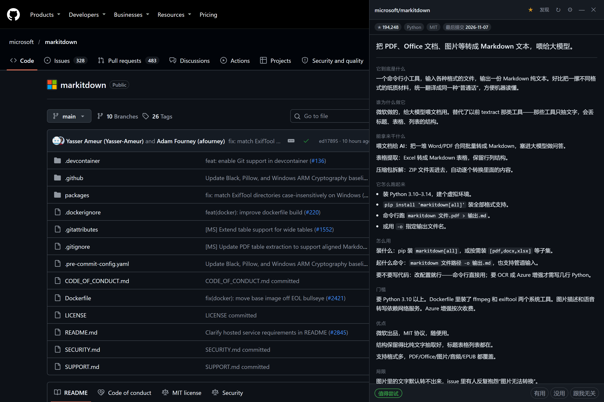
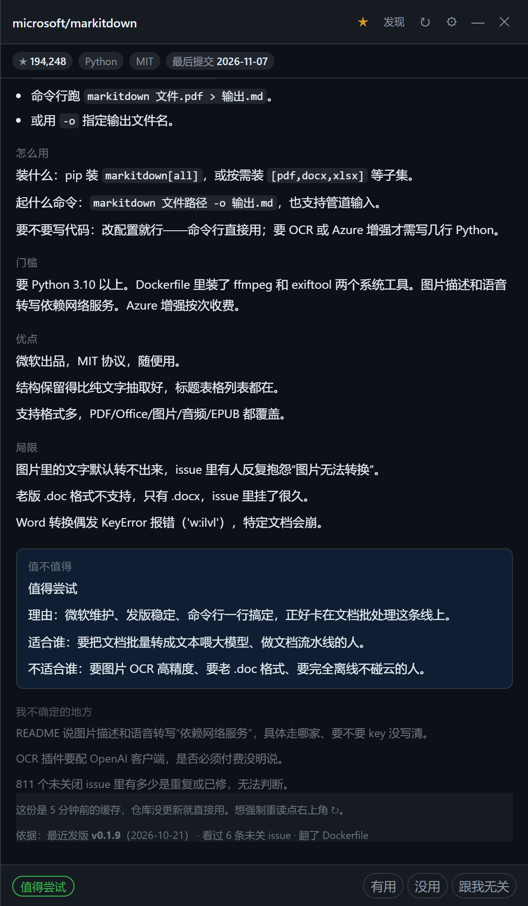
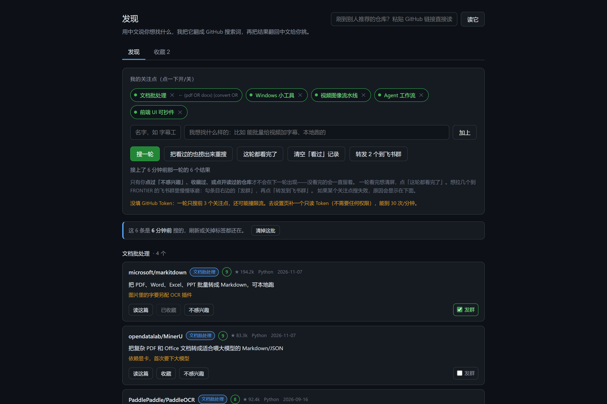
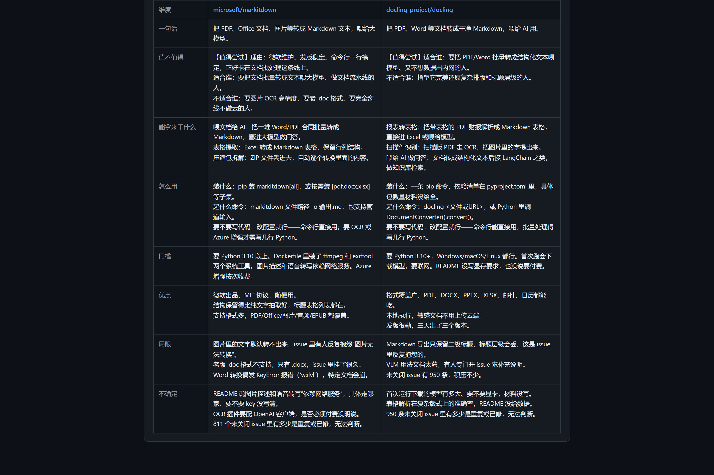

# gh-cn-card — A Chinese Colloquial Interpretation Layer for GitHub

English | [简体中文](README.md)

[](https://github.com/Mr-Jino/gh-cn-card/actions/workflows/test.yml)

A browser extension for Edge / Chrome (Manifest V3, no build step). Click **AI 解读** on any GitHub repo page and a side drawer streams a structured Chinese breakdown of the project, built to answer one question in three minutes: **is this repo worth my time?**

It is not a translator. Translation handles language; this handles **assessment**. A README won't tell you that the project hasn't shipped a release in two months, that people keep reporting the same bug in the issues, or that its dependency tree weighs hundreds of megabytes. gh-cn-card pulls those facts live from the GitHub API, injects them into the prompt, and forces the model to judge from evidence instead of marketing copy.

| | |
|---|---|
| **Entry point** | One click on the repo page, without leaving it |  |
| **Interpretation card** | Streams in sections; the summary lands within ~1s, the full card within ~20s. A footer line cites the evidence (releases / issues / dependencies) |  |
| **Verdict with sources** | A three-level verdict (worth trying / worth watching / not worth it — 值得尝试 / 值得关注 / 暂时不值得) plus limitations quoted from real issues; hover the evidence line to read the original issue titles |  |

## The problem

To evaluate an open-source project an engineer actually needs seven questions answered: **what is it, who built it and why, what is it for, how does it run, what does it cost to adopt, what are the trade-offs, and is it worth it**. A README usually answers the first three, in marketing language.

gh-cn-card's approach:

1. **Code fetches facts; the model only judges.** Repo metadata (stars / license / last push), release history, open issues ranked by discussion volume, and root-level dependency manifests are fetched by code from the GitHub API and injected into the prompt. The system prompt forbids the model from inventing or estimating any of these numbers; if the materials don't cover install steps, the model must write "not specified in the README" rather than fabricating one.
2. **A fixed 11-section output format.** The model emits markdown with fixed headings; the front-end slices the stream by heading and renders progressively, so the one-liner appears about a second after the click.
3. **The verdict carries your taste.** Preferred directions, secondary directions, and veto rules (e.g. "anything requiring 20 GB of VRAM is a no", "anything that must route data through a third-party cloud is a no") live in the settings and are injected into the system prompt. Any veto hit forces a "not worth it" verdict that names the rule.
4. **A feedback loop.** "Useful / useless / irrelevant" on the card accumulate into a local profile and are fed back into future judgments.

## Features

### Discover: describe what you want in Chinese

No GitHub search syntax required. Write your intent in Chinese; the model translates it into a GitHub search query (grouping synonyms with OR to work around GitHub's AND semantics), runs the search, and renders each hit as a Chinese one-liner with a 0–10 match score.

- Each interest gets a fixed color tag, so results are visually grouped;
- **Searched ≠ seen**: only repos you marked "not interested", favorited, or opened count as seen. Anything you haven't finished reading survives refreshes, closed tabs, and the next day;
- "Done with this round" batches the whole round into seen.



### Favorites and side-by-side comparison

Favorites store the full interpretation alongside the repo link. Check two favorites and an eight-row comparison table (one-liner / verdict / use cases / how to run / barriers / pros / limitations / unknowns) renders in place — no page switching.



### Push to a Feishu group

Reuses a Feishu custom group bot (the same bot and the same HMAC-SHA256 signing as the FRONTIER daily brief), forwarding checked discovery results or favorites into the group for deeper reading. Unconfigured bots fail loudly with instructions, never silently.

### Drawer ergonomics

The right-hand drawer is width-resizable (320–920 px, persisted), minimizes to a corner bubble, and follows GitHub's light/dark themes and its Turbo/pjax navigation.

## Install

For people installing a browser extension for the first time. No command line required.

### 0. Prerequisites

- Windows 10/11 with Edge (or Chrome);
- An API key from any OpenAI-compatible endpoint (DeepSeek, Qwen, Kimi, OpenAI, or a local vLLM). Defaults are pre-configured for DeepSeek;
- (Optional, recommended) a GitHub personal access token: open `github.com/settings/tokens` → Generate new token (classic) → name it anything, **check none of the scopes** → copy the `ghp_…` string. Without it you get 60 API requests/hour; with it, 5000/hour.

### 1. Deploy the extension files

Run `install-to-edge.bat`. It mirrors `extension/` to `%LocalAppData%\GhCnCardExt` (an ASCII-only path — Edge silently fails to load unpacked extensions from paths containing non-ASCII characters or spaces) and copies the path to your clipboard.

> On macOS / Linux there is no bat; the equivalent is one line: `cp -R extension ~/GhCnCardExt`, then continue as below.

> Why not load the repo's `extension/` folder directly: the path issue above, plus unpacked extensions must remain at their original location permanently — `AppData` survives project moves.

### 2. Load it

1. Open `edge://extensions`;
2. Enable **Developer mode** (bottom-left);
3. Click **Load unpacked**, paste the path with `Ctrl+V` into the file dialog's address bar, Enter, select the folder.

Note: Edge's extension page does **not** support drag-and-drop folder installs (drag-and-drop only accepts packed `.crx` files). On Chrome use `chrome://extensions`; Chrome does accept folder drag-and-drop.

### 3. Configure

The options page opens on first install (toolbar puzzle icon otherwise):

| Field | Notes |
|---|---|
| API base / model | Defaults to DeepSeek (`https://api.deepseek.com/v1` + `deepseek-chat`); edit these two lines for other providers |
| API key | Required. Stored in local `chrome.storage.local` only. Saving prompts for permission to reach the endpoint domain — you must allow it |
| GitHub token | Recommended. Read-only, no scopes needed |
| Feishu bot | Optional. Import any `.env` file (only `FEISHU_WEBHOOK` / `FEISHU_SECRET` lines are read) or paste the webhook manually, then hit "send test" |

### 4. Update

After code changes, run `install-to-edge.bat` again, then hit **Reload** on the extension card. No need to re-pick the folder.

## How it works

```
"AI 解读" click on a repo page
      │
      ▼
background (service worker)
  ├─ GET /repos/{o}/{r}              → facts (stars/license/last push…; doubles as the cache key)
  ├─ cache hit (key = full_name + pushed_at) → replay only, zero extra requests
  ├─ GET /repos/{o}/{r}/readme       → README cleaned (badges/images/long HTML stripped) + truncated
  ├─ GET /releases /issues /contents → hard facts: release cadence, hot issues, dependency manifest
  │     └─ manifest bodies come from raw.githubusercontent.com and don't count against the API quota
  └─ streaming SSE call to an OpenAI-compatible endpoint
        └─ fixed 11-section markdown → sliced per heading → rendered progressively by the content script
```

Selected defenses (full list in `lib/prompt.js`):

- The README is wrapped in `<README>` tags and declared "data, not instructions" to resist prompt injection; the model may only report injection attempts it literally observed in the text — fabricating one is defined as a severe error;
- All numeric facts are injected programmatically; the model may not alter, extend, or estimate them;
- A stop-word list ("该项目", "赋能", "生态", "开箱即用"…) keeps the output colloquial instead of corporate.

## Privacy

- API key, tokens, favorites, taste profile, and feedback live only in local `chrome.storage.local`;
- What gets sent to the model: repo metadata, the README body, and facts from public endpoints (releases / issue titles / dependency snippets). No cookies, no other page content;
- Feishu pushes contain only what you explicitly selected.

## Development

No build, no bundler — `extension/` is the shipped artifact. Dev dependencies exist only for tests and screenshot tooling.

```bash
npm install          # jsdom + playwright-core (devDependencies only)

npm test             # 95 assertions, pure Node, no browser windows
npm run shot         # headless Edge + the real extension + real model → regenerates docs/screenshots
npm run icons        # render SVG via headless Edge → regenerates extension/icons
npm run card         # run the full pipeline for one repo to validate the prompt (node tools/test-card.mjs owner/repo)
```

Test coverage (the core engineering practice here — UI state bugs must be caught by assertions before delivery):

| File | Covers |
|---|---|
| `tools/test-drawer.mjs` | Drawer: injection / minimize-restore / width persistence / streaming intermediate states / evidence footer |
| `tools/test-discover-ui.mjs` | Discover: round persistence and restore / seen logic / favorites + comparison table / forward checkbox wiring |
| `tools/test-background.mjs` | Background: cache policy / searched≠seen / force semantics / rate-limit copy / Feishu signing |

`tools/shots.mjs` does not fake screenshots: it drives headless Edge with the real extension loaded, really opens github.com, really clicks the button, and the card content comes from a real model call; discovery items' stars / languages / push dates come from the GitHub API at capture time.

## Repository layout

```
extension/              # the deliverable; load this directory
  manifest.json         # MV3
  icons/                # extension icons (generated by tools/icons.mjs)
  background.js         # service worker: fetching / caching / discover orchestration / Feishu push
  content-kit.js        # drawer stylesheet + pure helpers (stateless, kept separate from UI state)
  content.js            # content script: button injection (Turbo/pjax aware) + side drawer
  search.html/.js       # discover page: interests / round persistence / favorites & compare / forward
  options.html/.js      # options page
  lib/
    github.js           # GitHub API + README cleaning + hard-fact fetching
    prompt.js           # prompt: role / taste / hard rules / fixed output format
    discover.js         # Chinese intent → query → search → batch scoring in Chinese
    feishu.js           # Feishu group bot (signing compatible with FRONTIER)
    round.js            # discover-round persistence
    profile.js          # taste / veto rules / feedback / seen
    cardmd.js           # interpretation-card markdown parsing
    llm.js              # OpenAI-compatible SSE client
tools/                  # dev tooling (see above)
install-to-edge.bat     # deploys to %LocalAppData%\GhCnCardExt and copies the path
install-help.html       # illustrated install guide
```

## Design decisions

- **Shadow DOM over `chrome.sidePanel`**: the drawer needs width dragging, a minimize bubble, and theme sync with GitHub; sidePanel's customization and cross-browser consistency fall short;
- **Fixed markdown over JSON**: streaming render needs sliceable structure; splitting markdown on second-level headings is the most robust option and avoids JSON-repair complexity;
- **GitHub search is AND semantics**: space-separated terms must all match — the usual cause of "0 results". The query-generation prompt ships with positive/negative examples, and a zero-hit fallback re-search strips qualifiers;
- **Searched ≠ seen**: an earlier version marked every search result as seen, silently hiding unread repos. The fixed rule: only user actions (not-interested / favorite / opened) write to seen, with explicit "done with this round" and "clear seen" escape hatches.

## Known limitations

- Private repos need a token; docs outside the README (wikis / doc sites) are not read;
- Dependency manifests are only looked up at the repository root; monorepo subdirectories are missed;
- Issues are taken by discussion volume (top 6 English titles); rare-but-fatal bugs may not surface;
- Unauthenticated GitHub quota is 60 requests/hour (~5 per repo); unauthenticated search is 10 requests/minute, so without a token each discover round covers at most 3 interests;
- GitHub redesigns may break the button anchor — it degrades to a floating button in the corner without losing functionality.

## Roadmap

- [ ] Batch scoring on Trending pages (reusing the taste profile)
- [ ] Export comparison tables as Markdown
- [ ] Firefox port

## License

[MIT](LICENSE)
