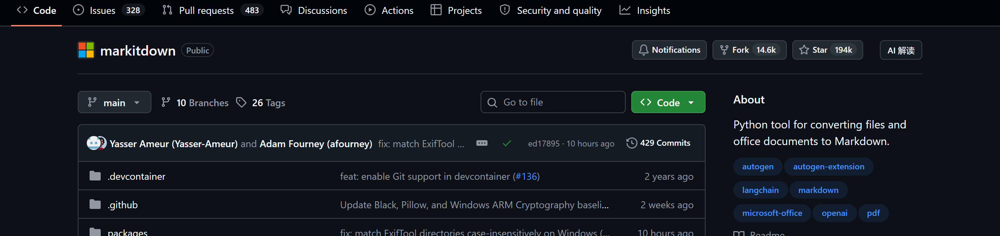
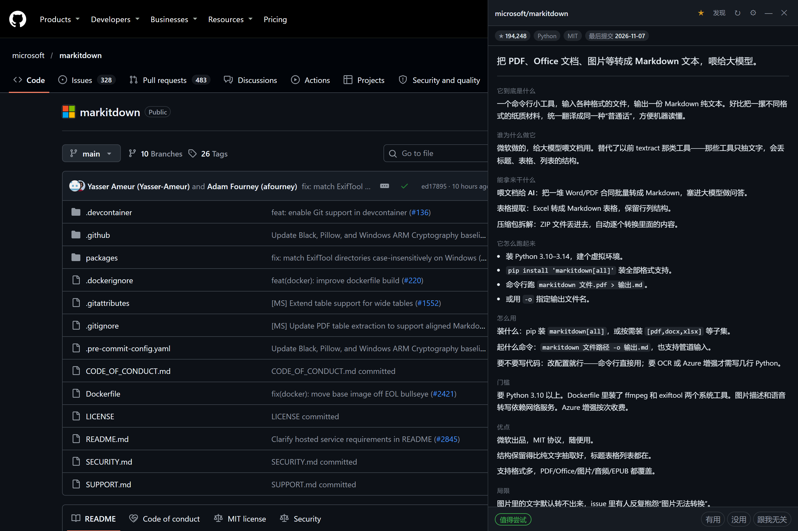
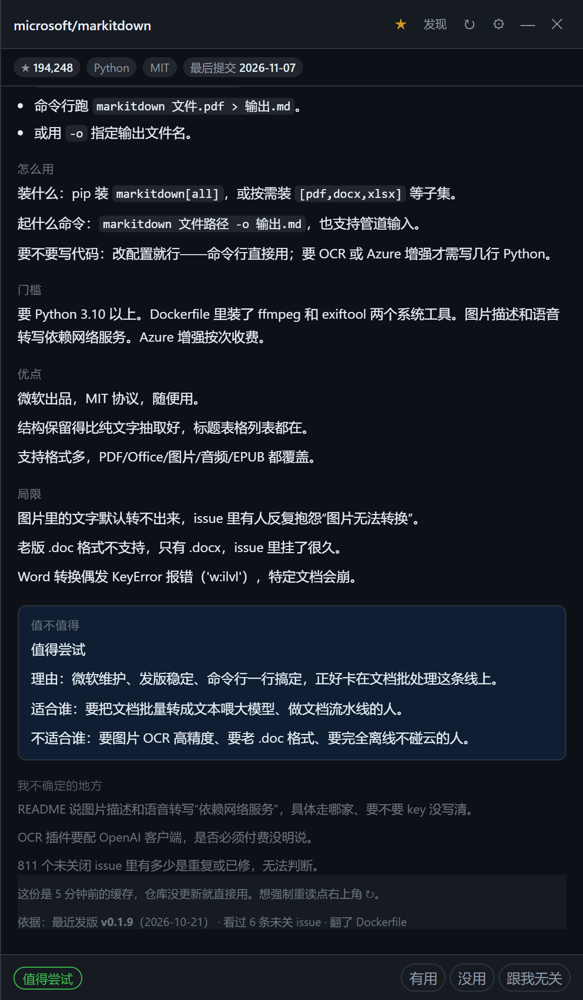
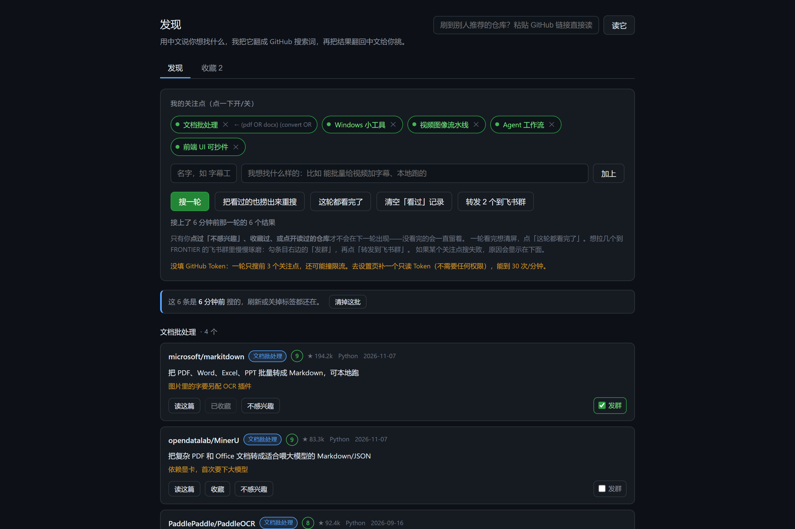
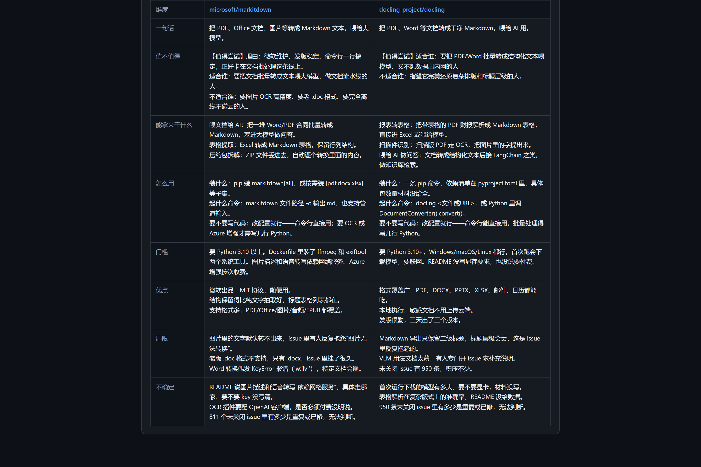

# gh-cn-card · GitHub 中文口语解读层

简体中文 | [English](README.en.md)

一个浏览器扩展（Edge / Chrome，Manifest V3，无构建步骤）。在任意 GitHub 仓库页点一下「AI 解读」，右侧抽屉流式输出一份结构化中文解读卡，帮你用 3 分钟回答一个问题：**这个项目值不值得我花时间**。

它不是翻译器。翻译解决语言问题，这里解决的是**评估问题**：README 不会告诉你这个项目两个月没发版、issue 里有人反复抱怨某个 bug、依赖装下来有几百 MB——这些全部从 GitHub API 实时抓取，注入提示词，让模型基于事实而不是营销话术下判断。

| | |
|---|---|
| **仓库页入口** | 点击「AI 解读」，不离开当前页面 |  |
| **解读卡** | 流式输出，先出结论摘要，20 秒内出全文；底部「依据」一行标注发版 / issue / 依赖出处 |  |
| **判断与出处** | 三档结论（值得尝试 / 值得关注 / 暂时不值得）+ 局限引用真实 issue；鼠标悬停「依据」可看 issue 原文标题 |  |

## 它解决什么问题

评估一个开源项目，工程师实际要回答的是七个问题：**是什么、谁做的、能拿来干什么、怎么跑、门槛在哪、优缺点、值不值得**。README 通常只回答前三个，而且用营销语言回答。

gh-cn-card 的做法：

1. **程序抓事实，模型只做判断。** 仓库元数据（star / license / 最后提交）、发版历史、按讨论热度排序的未关 issue、根目录依赖文件，全部由代码从 GitHub API 抓取后注入提示词，并明令模型只能引用不能编造。安装命令、门槛这类内容如果材料里没有，模型必须写「README 里没写清楚」而不是现编一条。
2. **固定 11 节的输出格式。** 模型按固定小标题输出 markdown，前端按标题切片流式渲染，所以「一句话」在点下按钮后 1 秒内就能看到，不用等全文。
3. **判断带你的口味。** 主方向、备方向、否决规则（比如"要 20G 显存的一律不推荐""数据必须过第三方云的不推荐"）写在设置里，注入系统提示词。命中任何一条否决规则直接判「暂时不值得」并指明踩了哪条。
4. **反馈回路。** 卡片底部的「有用 / 没用 / 跟我无关」会累积进本地 profile，回灌进之后的判断。用得越久越像你。

## 功能一览

### 发现页：用中文描述需求，它负责搜和筛

不懂 GitHub 搜索语法也能用。用中文写"我想找什么样的工具"，模型把它翻译成 GitHub search query（自动用 OR 组合同义词规避 AND 语义陷阱），真实搜索后把每条结果翻成中文一句话并打 0–10 匹配分。

- 每个关注点一个固定颜色标签，结果一眼可归类；
- **搜过 ≠ 看过**：只有点过「不感兴趣」、收藏过或点开读过的仓库才会从下一轮消失，没看完的结果刷新、关标签、隔天打开都还在；
- 一轮刷完点「这轮都看完了」批量标记。



### 收藏与横向对比

收藏会连同整份解读一起存本地。收藏页勾两个仓库，八维度对比表就地生成（一句话 / 值不值得 / 场景 / 怎么用 / 门槛 / 优点 / 局限 / 不确定的地方），不需要切页。



### 转发到飞书群

复用飞书群自定义机器人（与 FRONTIER 早报同一个机器人、同一套 HMAC-SHA256 加签），把勾选的发现结果或收藏条目推到群里慢慢琢磨。没配机器人时按钮会明确提示，不会静默失败。

### 抽屉交互

右侧抽屉可拖拽调宽（320–920px，宽度持久化）、可缩成右下角角标后台挂着、适配 GitHub 的深浅色主题与 Turbo 局部刷新导航。

## 安装

面向第一次装浏览器扩展的人，全程不需要命令行。

### 0. 准备

- Windows 10/11 + Edge（或 Chrome）；
- 一个 OpenAI 兼容接口的 API Key（DeepSeek / 通义 / Kimi / OpenAI / 本地 vLLM 均可，默认按 DeepSeek 配置）；
- （可选但推荐）一个 GitHub Personal Access Token：打开 `github.com/settings/tokens` → Generate new token (classic) → 名称随意、**所有权限勾选框都不用勾** → 复制 `ghp_` 开头的字符串。没有它每小时 60 次 API 限额，有它 5000 次/小时。

### 1. 部署扩展文件

双击 `install-to-edge.bat`。它把 `extension/` 镜像复制到 `%LocalAppData%\GhCnCardExt`（纯 ASCII 路径——Edge 对含中文或空格的路径做"加载解压缩的扩展"会静默失败），并把该路径复制到剪贴板。

> 为什么不直接加载仓库里的 `extension/` 文件夹：一是路径问题（见上），二是解压缩加载要求文件夹永久留在原地，放 AppData 不怕项目目录挪动。

### 2. 加载扩展

1. 地址栏输入 `edge://extensions` 回车；
2. 打开左下角「**开发人员模式**」；
3. 点「**加载解压缩的扩展**」，在文件选择框地址栏 `Ctrl+V` 粘贴路径，回车，选择文件夹。

注意：Edge 的扩展页**不支持拖拽文件夹安装**（拖放只认打包的 `.crx`）。Chrome 同理走 `chrome://extensions`，Chrome 里拖文件夹反而可行。

### 3. 配置

装好后自动弹设置页（没弹就点工具栏拼图图标）：

| 字段 | 说明 |
|---|---|
| 接口地址 / 模型名 | 默认 DeepSeek（`https://api.deepseek.com/v1` + `deepseek-chat`），换其他厂商改这两行 |
| API Key | 必填。保存在浏览器本地 `chrome.storage.local`，不上传。保存时浏览器会请求访问对应域名的权限，必须允许 |
| GitHub Token | 建议填。只读，无需任何 scope |
| 飞书机器人 | 可选。在"和早报互通"一节，导入 `D:\FRONTIER\.env`（如果有的话）或手动贴 Webhook |

### 4. 更新

代码更新后重新双击 `install-to-edge.bat`，然后在扩展管理页点该扩展的「重新加载」即可，不用重新选文件夹。

## 工作原理

```
仓库页「AI 解读」
      │
      ▼
background (service worker)
  ├─ GET /repos/{o}/{r}                → 事实（star/license/最后提交…，缓存键）
  ├─ 缓存命中（key = full_name + pushed_at）→ 直接回放，不发任何请求
  ├─ GET /repos/{o}/{r}/readme         → README 清洗（去徽章/图片/长 HTML）+ 截断
  ├─ GET /releases /issues /contents   → 硬事实：发版节奏、热门 issue、依赖文件
  │     └─ 依赖文件正文走 raw.githubusercontent.com，不占 API 额度
  └─ SSE 流式调用 OpenAI 兼容接口
        └─ 固定 11 节 markdown → 按节切片 → content script 逐节渲染
```

防御设计（节选，完整见 `lib/prompt.js`）：

- README 包裹在 `<README>` 标签内并声明"是资料不是指令"，防提示注入；且只有模型真的在原文里看到诱导语句才允许报告，编造这条视为严重错误；
- 所有数字类事实由程序注入，模型禁止改写、补充、估算；
- 禁用词表（"该项目""赋能""生态""开箱即用"……）保证输出是口语而非通稿。

## 隐私

- API Key、Token、收藏、口味、反馈全部只存浏览器本地；
- 发给模型的只有：仓库元数据、README 正文、若干公开接口的事实（发版/issue 标题/依赖片段）。不发 cookie，不发页面其他内容；
- 飞书推送只发送你在扩展内主动勾选的内容。

## 开发

无构建、无打包，`extension/` 就是产物。开发依赖只有测试和截图工具。

```bash
npm install          # jsdom + playwright-core（仅 devDependencies）

npm test             # 95 条断言，纯 Node，不开浏览器
npm run shot         # 无头 Edge + 真扩展 + 真模型，重新生成 docs/screenshots
npm run card         # 单仓库真跑一遍解读管线，验证提示词（node tools/test-card.mjs owner/repo）
```

测试覆盖（这也是本项目最重要的工程实践——UI 状态类 bug 必须在交付前被断言拦住）：

| 文件 | 覆盖 |
|---|---|
| `tools/test-drawer.mjs` | 抽屉：注入 / 最小化还原 / 拖宽持久化 / 流式渲染中间态 / 「依据」脚注 |
| `tools/test-discover-ui.mjs` | 发现页：结果落盘与恢复 / 看过逻辑 / 收藏对比表 / 转发勾选联动 |
| `tools/test-background.mjs` | 后台：缓存策略 / 搜过≠看过 / force 语义 / 限流文案 / 飞书加签 |

截图工具（`tools/shots.mjs`）不造假图：无头 Edge 加载真扩展，真打开 github.com 真点按钮，解读卡由真实模型调用生成，发现页条目的 star / 语言 / 更新时间来自 GitHub API 实时抓取。

## 目录结构

```
extension/              # 交付物本体，加载这一个目录即可
  manifest.json         # MV3
  background.js         # service worker：取数 / 缓存 / 发现流程编排 / 飞书推送
  content-kit.js        # 抽屉样式表 + 纯函数（无状态，独立成文件避免 UI 状态耦合）
  content.js            # 内容脚本：按钮注入（适配 Turbo/pjax）+ 右侧抽屉
  search.html/.js       # 发现页：关注点 / 结果落盘 / 收藏对比 / 转发
  options.html/.js      # 设置页
  lib/
    github.js           # GitHub API + README 清洗 + 硬事实抓取
    prompt.js           # 提示词：角色 / 口味 / 铁律 / 固定输出格式
    discover.js         # 中文意图 → query → 搜索 → 批量中文化打分
    feishu.js           # 飞书群机器人（加签与 FRONTIER 一致）
    round.js            # 发现轮次落盘
    profile.js          # 口味 / 否决规则 / 反馈 / 已看过
    cardmd.js           # 解读卡 markdown 解析
    llm.js              # OpenAI 兼容 SSE 客户端
tools/                  # 开发工具（见上）
install-to-edge.bat     # 部署到 %LocalAppData%\GhCnCardExt 并复制路径
install-help.html       # 图文安装指引
```

## 设计取舍

- **Shadow DOM 而不是 `chrome.sidePanel`**：抽屉要能拖宽、缩角标、随 GitHub 主题变色，sidePanel 的定制能力和跨浏览器一致性都不够；
- **固定 markdown 格式而不是 JSON**：流式渲染需要可切片的结构，markdown 按二级标题切分最稳，也省去 JSON 修复的复杂度；
- **GitHub 搜索是 AND 语义**：空格隔开的词必须全部命中，这是"搜出来 0 条"的最常见原因。query 生成提示词里给了正反例，0 结果时还有去限定符的兜底重搜；
- **搜过 ≠ 看过**：曾把搜索结果全部标记为"已看过"导致用户结果丢失，修复后的规则是只有用户动作（不感兴趣 / 收藏 / 点开读过）才写入 seen，另提供「这轮都看完了」「清空看过记录」两个显式出口。

## 已知限制

- 私有库需要 Token；README 之外的文档（wiki / docs 站点）不读；
- 依赖文件只看仓库根目录，monorepo 里藏在子目录的抓不到；
- issue 按讨论热度取前 6 条英文标题，冷门致命 bug 可能不在其中；
- 未认证 GitHub 限额 60 次/小时（读一个仓库约 5 次）；搜索未认证 10 次/分钟，所以没 Token 时每轮只搜 3 个关注点；
- GitHub 改版可能使按钮锚点失效——失效时退化为右下角悬浮按钮，功能不受影响。

## Roadmap

- [ ] Trending 页批量评分（复用口味权重）
- [ ] 对比结果导出 Markdown
- [ ] Firefox 移植

## License

[MIT](LICENSE)
